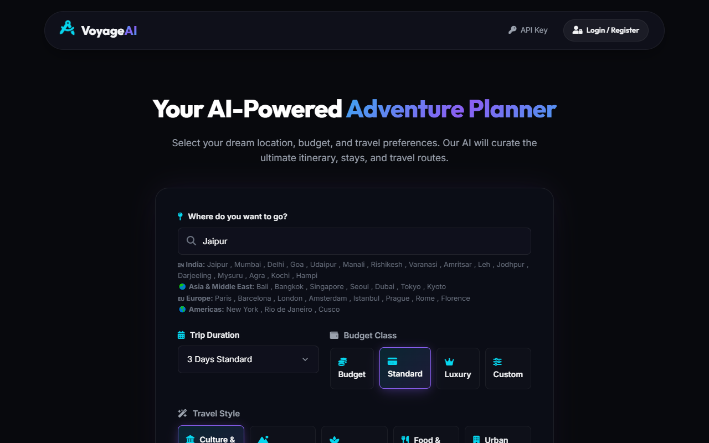
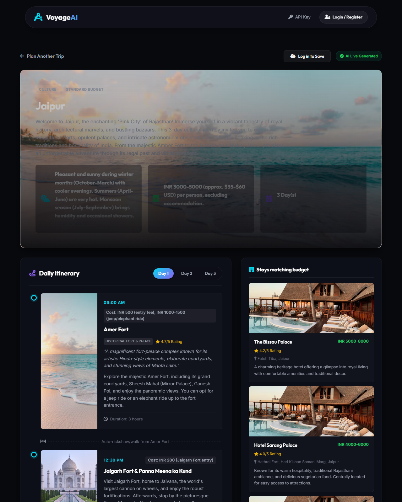

# VoyageAI: AI Travel Planner

Plan a trip to any city in seconds. Pick a destination, trip length, budget and travel style,
and VoyageAI uses Google Gemini to build a full day-by-day itinerary. Each plan includes hotels
that fit the budget, the attractions worth seeing, the route between stops and local tips.

Built with **Python and Flask**. Every page is rendered on the server, so the app runs without any JavaScript.



## Features

- **AI itineraries for any destination.** Gemini returns a structured JSON plan with morning, midday
  and evening stops, costs, durations and transport between them.
- **Budget-aware stays.** Pick Budget, Standard or Luxury, or type your own budget (e.g. "₹20,000 total").
- **Travel styles.** Choose Culture, Adventure (with treks and base villages), Relaxation, Food, or Urban.
- **Daily route map.** A route map drawn on the server (SVG) shows each day's stops, with a one-click link to open the route in Google Maps.
- **Accounts and saved trips.** Register, log in, save plans to SQLite, then search, filter and delete them.
- **Offline demo mode.** 34 pre-loaded cities work without an API key. If the AI is down, the app falls back to them.
- **Secure by default.**
  - The API key stays on the server, and passwords are hashed.
  - Forms are protected against CSRF, and all output is HTML-escaped.
  - The database and source files are never served to the browser.



## Tech stack

| Layer | Technology |
| --- | --- |
| Backend | Python 3, Flask |
| AI | Google Gemini Flash (structured JSON output via response schema) |
| Database | SQLite |
| Frontend | Jinja2 templates, HTML5, CSS3 (no JavaScript) |
| Auth | Werkzeug password hashing, Flask sessions, CSRF tokens |

## How it works

```
Browser form ──POST──▶ Flask /generate
                         │
                         ├─ no API key ──▶ demo plan (data/demo_plans.json)
                         │
                         └─ background thread ──▶ Gemini API ──▶ check image links ──▶ SQLite
                                                                                    │
Browser ◀── "Generating…" page (refreshes itself every 3 s) ◀────────────────────────┘
        ◀── itinerary page (day tabs, hotels, spots, SVG route map)
```

The Gemini call takes 40 to 60 seconds, so it runs in a background thread. While it runs, a plain HTML
`<meta refresh>` page polls for the result. That keeps the UI responsive without any client-side code.

## Project structure

```
server.py           Flask routes: planner, plans, auth, saved trips
gemini_service.py   Prompt, JSON response schema and Gemini API client
planner.py          Demo plans, photo lookup, map coordinates, SVG route data
data/               Demo city plans and lookup tables (JSON)
templates/          Jinja2 HTML templates
static/             Stylesheet and images
```

## Run it locally

```bash
git clone https://github.com/kolambekarpratik123-source/Travel-planner.git
cd Travel-planner
pip install -r requirements.txt
cp .env.example .env        # Windows: copy .env.example .env
```

Add your free Gemini key from [Google AI Studio](https://aistudio.google.com/) to `.env`:

```
GEMINI_API_KEY=your-key
FLASK_SECRET_KEY=any-long-random-string
```

```bash
python server.py
```

Then open http://127.0.0.1:5000. Without a key, the app runs in demo mode.

## Deploy

The repo includes a `render.yaml`, so it deploys to [Render](https://render.com) for free:
**New → Blueprint**, pick this repo, and paste your `GEMINI_API_KEY` when asked.
It runs on Gunicorn. On the free plan the app sleeps when idle, and saved trips reset on each redeploy.

## Author

[kolambekarpratik123-source](https://github.com/kolambekarpratik123-source)
